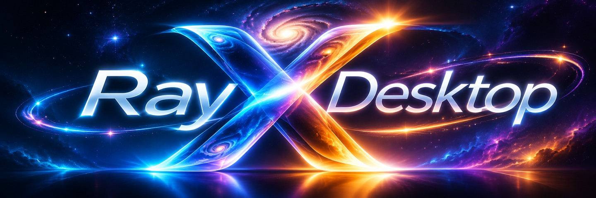
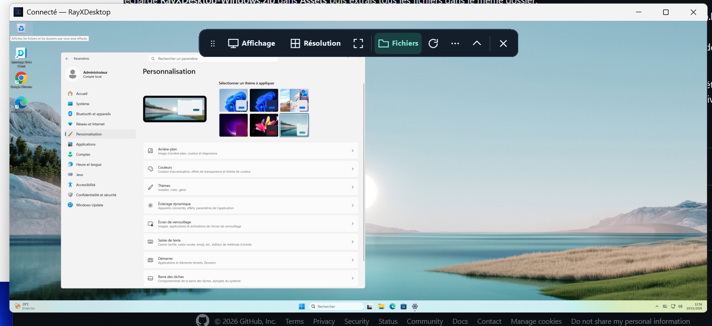

# Ray‑X‑Desktop

[Français](README.md) · **English**

  

**Open a Windows desktop in its own window while you keep working on your main desktop.** Ray‑X‑Desktop uses Windows Child Sessions for the local desktop. Beta versions also let you manage Remote Desktop (RDP) connections in the app.

Ray‑X‑Desktop is a fork of [Ray Desktop, created by raydoomed](https://github.com/raydoomed/Ray-Desktop). D.Synx continues to develop this version under the [MIT license](LICENSE).

[Download stable 1.4.6](https://github.com/D-Synx/Ray-X-Desktop/releases/tag/v1.4.6) · [Try the 1.6.0 beta](https://github.com/D-Synx/Ray-X-Desktop/actions/workflows/ray-gpu-beta.yml?query=branch%3Abeta%2F1.6.0-gpu-vulkan) · [Windows guide (French)](https://github.com/D-Synx/Ray-X-Desktop/blob/beta/1.6.0-gpu-vulkan/maintenance/README.fr.md)

## Two ways to use it

- **On the same PC.** Open a second desktop for maintenance or testing while keeping access to your main session.
- **On other PCs.** In the beta, connect to PCs you have permission to access by entering a DNS name or IP address or importing an `.rdp` file. Switch between saved connections in the sidebar or open two desktops side by side.

Use the toolbar to change display settings and resolution, transfer files, or reconnect.

*The toolbar in the stable 1.4.6 release. The screenshot shows the French interface.*

## What’s coming in 1.6.0

**Beta 3** is available for testing on Windows. Open a successful GitHub Actions build using the beta link above, download the Windows artifact, and extract the portable ZIP inside.

| Feature | What you can try |
| --- | --- |
| **GPU-accelerated thumbnails** | Open **More → Graphics acceleration** and select Direct3D 11 or Vulkan to scale session previews on a compatible GPU. The Windows renderer serves as a fallback. |
| **Fast RDP profile** | Reduce visual effects and cap automatic resolution at 1,280 × 720 after reconnecting. Live desktops are rendered by the Windows RDP control. |
| **Per-session resolution** | Match the current screen resolution, select a specific resolution, restore the starting size, or return to automatic sizing. |
| **GPU diagnostics** | View available driver information, the renderer used for the most recent thumbnail, and its processing time. |

**Before the final release**, we still need to measure performance on physical GPUs, test resizing in split view and across multiple monitors, and compare responsiveness with the Fast RDP profile on different connections. Vulkan Video decoding for a future RDP engine remains a research topic.

[GPU technical notes and test protocol (French)](https://github.com/D-Synx/Ray-X-Desktop/blob/beta/1.6.0-gpu-vulkan/maintenance/GPU.fr.md) · [Follow 1.6.0 development](https://github.com/D-Synx/Ray-X-Desktop/pull/2)

## Get started on Windows

1. Extract the ZIP and keep its files together.
2. Run `RayXDesktop.exe` to open the local session. The Windows guide covers system requirements, enabling Child Sessions, and connecting with an authorized account.

[Windows guide and build instructions (French)](https://github.com/D-Synx/Ray-X-Desktop/blob/beta/1.6.0-gpu-vulkan/maintenance/README.fr.md) · [Original technical documentation (English)](https://github.com/D-Synx/Ray-X-Desktop/blob/f0409cb35b09de843d9709c2f5d26d506c0ef88c/README.md)
