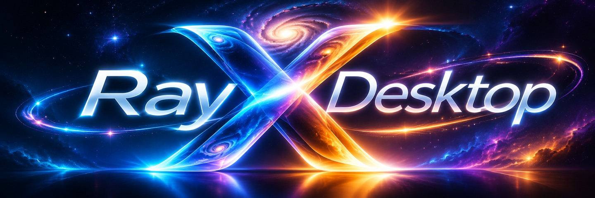

# Ray‑X‑Desktop

  

**Ouvre un bureau Windows dans une fenêtre dédiée et continue à travailler sur ton bureau principal.** Ray‑X‑Desktop utilise les sessions enfants de Windows pour le bureau local. Les versions bêta regroupent aussi les connexions Bureau à distance (RDP) dans l’application.

[Télécharger la version stable 1.4.6](https://github.com/D-Synx/Ray-X-Desktop/releases/tag/v1.4.6) · [Tester la bêta 1.6.0](https://github.com/D-Synx/Ray-X-Desktop/actions/workflows/ray-gpu-beta.yml?query=branch%3Abeta%2F1.6.0-gpu-vulkan) · [Guide en français](https://github.com/D-Synx/Ray-X-Desktop/blob/beta/1.6.0-gpu-vulkan/maintenance/README.fr.md)

## Deux façons de l’utiliser

- **Sur le même PC.** Ouvre un bureau secondaire pour une intervention ou un essai, tout en gardant ta session principale accessible.
- **Sur d’autres PC.** Dans la bêta, ajoute les machines auxquelles tu as accès par nom DNS, adresse IP ou fichier `.rdp`. Retrouve les connexions enregistrées dans la barre latérale, bascule de l’une à l’autre ou affiche deux bureaux côte à côte.

La barre d’outils donne accès à l’affichage, à la résolution, aux transferts de fichiers et à la reconnexion.

*Aperçu de la barre d’outils dans la version stable 1.4.6.*

## Ce qui arrive dans la 1.6.0

La **bêta 3** est disponible pour les essais sous Windows. Dans la compilation GitHub Actions ci-dessus, télécharge l’artefact Windows, puis extrais le ZIP portable qu’il contient.

| Nouveauté | Ce que tu peux essayer |
| --- | --- |
| **Miniatures accélérées par GPU** | Sous **Plus → Accélération graphique**, choisis Direct3D 11 ou Vulkan pour mettre à l’échelle les aperçus des sessions sur un GPU compatible. Le mode Windows sert de repli. |
| **Profil RDP rapide** | Réduis les effets visuels et plafonne la résolution automatique à 1 280 × 720 après reconnexion. Le contrôle RDP de Windows affiche les bureaux en direct. |
| **Résolution par session** | Agrandis le bureau à la définition de l’écran, choisis une définition précise ou reviens à la taille de départ et au mode automatique. |
| **Diagnostic GPU** | Consulte les informations disponibles sur le pilote, le moteur utilisé pour la dernière miniature et le temps de traitement. |

**À valider avant la version finale** · Mesurer les gains sur des GPU réels, vérifier le redimensionnement en vue scindée et sur plusieurs écrans, puis comparer la fluidité du profil RDP rapide sur plusieurs connexions. Le décodage Vulkan Video pour un futur moteur RDP reste une piste à étudier.

[Notes techniques et protocole de test GPU](https://github.com/D-Synx/Ray-X-Desktop/blob/beta/1.6.0-gpu-vulkan/maintenance/GPU.fr.md) · [Suivre le développement de la 1.6.0](https://github.com/D-Synx/Ray-X-Desktop/pull/2)

## Démarrer sous Windows

1. Décompresse le ZIP et garde ses fichiers dans le même dossier.
2. Lance `RayXDesktop.exe` pour ouvrir la session locale. Le guide explique les prérequis Windows, l’activation des sessions enfants et les options de connexion à un compte autorisé.

[Guide Windows et compilation](https://github.com/D-Synx/Ray-X-Desktop/blob/beta/1.6.0-gpu-vulkan/maintenance/README.fr.md) · [Documentation technique du projet d’origine](https://github.com/D-Synx/Ray-X-Desktop/blob/f0409cb35b09de843d9709c2f5d26d506c0ef88c/README.md)

Maintenu par **D.Synx** · Issu de [Ray Desktop par raydoomed](https://github.com/raydoomed/Ray-Desktop) · [Licence MIT](LICENSE)
