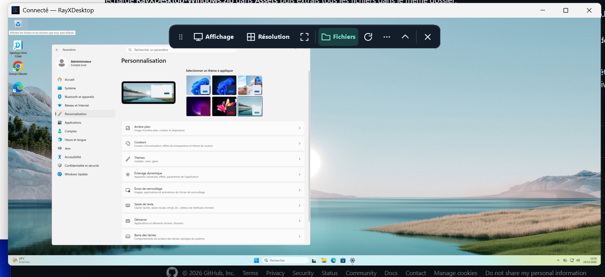

# RayXDesktop

**Maintained by D.Synx** · Based on [Ray Desktop by raydoomed](https://github.com/raydoomed/Ray-Desktop) · MIT

RayXDesktop displays a local Windows Child Session in a separate window. The floating toolbar lets you change the display mode and resolution, switch to fullscreen, transfer selected files, reconnect and close the session. Collapse it to a draggable monitor badge.

[Guide en français](maintenance/README.fr.md) · [Stable 1.4.6](https://github.com/D-Synx/Ray-Desktop/releases/tag/v1.4.6) · [1.4.7 beta](https://github.com/D-Synx/Ray-Desktop/releases/tag/v1.4.7-beta)

## Aperçu de la barre · 1.4.6

**Fichiers** et **Reconnecter** sont accessibles directement dans la nouvelle barre.

## Run

1. Download **RayXDesktop-Windows.zip** from the beta release Assets and extract it.
2. Keep both EXEs, both DLLs, and **RayXDesktop.bat** in the same folder.
3. Run **RayXDesktop.exe** for the current Windows account. To connect with another authorized account, set the account name in **RayXDesktop.bat**. RayXDesktop prompts for that account’s password when it connects.
4. If Child Sessions are disabled, an authorized administrator can run **EnableChildSessions.exe --enable-child-sessions**. A Windows sign-out and sign-in may be required after first activation.

The interface uses French on French Windows installations and English elsewhere. Pass **--lang=fr** or **--lang=en** to choose a language. Use **--dynamic** to start with a window-sized desktop. See the French guide for the existing account-based startup options.

## Clipboard and files

Windows controls native RDP text clipboard redirection in sessions opened with an explicit account. To copy files, select them in the source Explorer and press **Ctrl+C**, then click **Files** on the RayXDesktop toolbar. RayXDesktop resolves the connected account’s Desktop and copies without overwriting existing files. The process needs permission to read the source and write to the destination.

## Build and test

Use Windows PowerShell with the .NET Framework compiler and Windows SDK tools, including **AxImp.exe**. Run **.\tests\run-tests.ps1** for core tests and **.\maintenance\build-portable.ps1** for the portable package. The Windows workflow runs both the core and maintenance profile tests. Set **RAYDESKTOP_SDK_ROOT** if the SDK is installed outside the usual locations.

See the [French guide](maintenance/README.fr.md#vérifier-et-signer-le-zip) for checksum verification, optional Authenticode signing and the three-PC pilot checklist.

## Diagnose

The **More** menu opens the log folder. The existing path remains **%LOCALAPPDATA%\RayDesktop\Logs\child-session.log**. Look for **RDP connected in** to distinguish the Windows connection wait from the time it takes the toolbar to appear.

## Credits

RayXDesktop maintenance and Windows packaging by **D.Synx**. Original Ray Desktop code by **raydoomed**. See [LICENSE](LICENSE).
