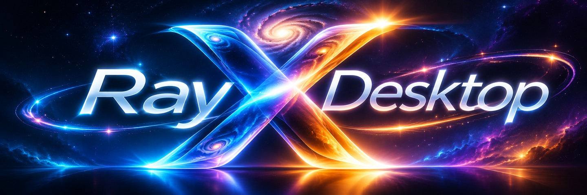

## RayˣDesktop 1.5.0.1 bêta publique · D.Synx

- Le bureau local s’ouvre au démarrage si aucune session distante n’a pu se reconnecter et que le bureau local est toujours sélectionné.
- Une session distante en échec peut être relancée depuis sa carte. Déconnecter ou reconnecter pendant la résolution du nom annule la tentative en attente.
- Les transferts de fichiers vérifient de nouveau le presse-papiers et la session avant la copie. La copie intégrée refuse aussi les chemins qui passent par une jonction.
- En cas d’échec d’écriture de `data.ini`, l’option d’oubli du mot de passe reste disponible. Un mot de passe refusé par Windows ne fait pas l’objet d’une nouvelle tentative automatique pendant la même exécution.
- Le titre RayˣDesktop, la bannière et les icônes sont inclus. Le programme d’activation adopte aussi la nouvelle icône Windows.

Télécharge **RayXDesktop-Windows.zip**, extrais tous les fichiers dans un même dossier et conserve ton `data.ini` lors de la mise à jour. Le [guide de test Windows](https://github.com/D-Synx/Ray-Desktop/blob/v1.5.0.1/maintenance/README.fr.md) détaille les scénarios à vérifier sur les sessions locales et distantes.
